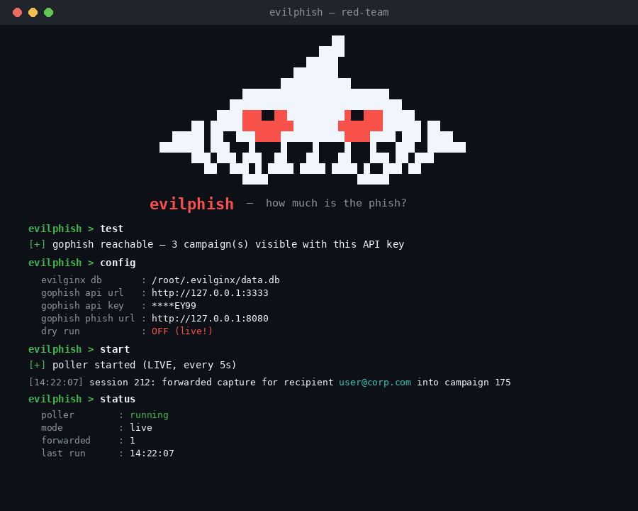

<p align="center">
  
</p>

# Evilphish

An external bridge, written in Go, that forwards credentials captured by
**evilginx3** into **gophish** so they appear as native **Submitted Data**
on the matching campaign recipient — **without modifying the source code of
either tool**.

**v2** adds an evilginx-style interactive console: a startup banner and a
built-in shell where you set every parameter at runtime (no hand-editing of
`config.json`), test the gophish connection, start/stop the forwarder and
watch live status.

For **authorized** engagements only (red team / phishing assessments with
explicit written permission). Do not use it against systems you are not
authorized to test.

---

## What it does

1. Reads evilginx's `data.db` **read-only** (a Redis-protocol RESP append-only
   log — parsed directly, no Redis client, no writes).
2. For every captured session with plaintext credentials, it extracts the
   gophish tracking id (`rid`) from the lure URL (`landing_url`).
3. It asks gophish's admin API which campaign/recipient that `rid` belongs to.
4. It replays the capture against gophish's **phish server** (a `GET` for
   *Clicked Link*, then a `POST` for *Submitted Data*), exactly as a browser
   would. Nothing in gophish is patched or bypassed.

---

## Build

```bash
go mod tidy        # fetches readline + color (first build only)
go build -o evilphish .
```

No build-time config is required; everything is set from the console.

---

## Quick start (interactive)

<p align="center">
  
</p>

Just run it:

```bash
./evilphish
```

You get the banner and a prompt. First run, set things up from inside:

```
evilphish > config gophish api_url http://127.0.0.1:3333
evilphish > config gophish api_key <YOUR-GOPHISH-API-KEY>
evilphish > config gophish phish_url http://127.0.0.1:8080
evilphish > config evilginx db /root/.evilginx/data.db
evilphish > test                 # verify gophish is reachable
evilphish > sessions             # sanity-check data.db parsing
evilphish > start                # begins forwarding (DRY-RUN by default)
evilphish > status               # running? counters? last error?
```

Every `config ...` change is **saved to `config.json` automatically** — the
file is just the persistence layer now, you never need to edit it by hand.

When the dry-run output looks right, go live:

```
evilphish > dryrun off
evilphish > restart              # if already running
```

Type `help` for the full command reference.

### Console commands

| Command | What it does |
|---|---|
| `config` | show all settings (API key masked) |
| `config gophish api_url <url>` | gophish admin API base url |
| `config gophish api_key <key>` | gophish API key |
| `config gophish phish_url <url>` | gophish phish server (where captures are POSTed) |
| `config gophish insecure true\|false` | accept gophish self-signed admin cert |
| `config evilginx db <path>` | path to evilginx `data.db` |
| `config poll <seconds>` | re-scan interval |
| `config rid_param <name>` | tracking param name (default `rid`) |
| `config mapping <field> <tmpl>` | map a gophish form field → capture template (empty tmpl removes it) |
| `dryrun on\|off` | simulate vs actually inject |
| `test` | verify gophish reachability + API key |
| `sessions` | list sessions currently in `data.db` |
| `start` / `stop` / `restart` | control the background forwarder |
| `status` | running state, counters, last error |
| `clear` / `help` / `exit` | — |

Placeholders for `mapping`: `{{username}}`, `{{password}}`, `{{tokens}}`
(raw captured cookies/auth tokens as JSON), `{{session_id}}`, `{{phishlet}}`,
`{{remote_addr}}`, `{{update_time}}`.

> **Which changes need a `restart`?** gophish url/key/tls, the evilginx db
> path and the state file are read when the forwarder starts, so change them
> then `restart`. Everything else (dry-run, poll interval, rid param, phish
> url, user-agent, form mapping) applies live.

---

## Headless mode (systemd / unattended)

The interactive shell needs a terminal. When there is no TTY (e.g. under
systemd) the binary **automatically** runs headless — or force it with
`--headless`. In headless mode it needs a complete `config.json` and just
forwards, exactly like v1.

```ini
# /etc/systemd/system/evilphish.service
[Unit]
Description=evilphish gophish-evilginx bridge
After=network.target

[Service]
Type=simple
WorkingDirectory=/root/evilphish
ExecStart=/root/evilphish/evilphish --headless --config /root/evilphish/config.json
Restart=on-failure
RestartSec=5

[Install]
WantedBy=multi-user.target
```

```bash
systemctl daemon-reload
systemctl enable --now evilphish
journalctl -u evilphish -f
```

> The journal/log output contains captured plaintext credentials. Restrict
> read access to it like any other part of the engagement's capture chain,
> and keep `config.json` at `chmod 600` (the tool writes it that way).

Other flags: `./evilphish -dump-schema` (parse `data.db`, print a summary,
exit) and `./evilphish --version`.

---

## Validated architecture

Single host; the bridge talks to gophish over loopback.

```
          Victim's browser
                 |  email link: https://<lure-host>/<lure-path>?rid=XXXX
                 v
        +------------------+   proxies login to the real/origin site
        |    evilginx      |  --->  (your target, or the test rig below)
        |  :443  (lures)   |
        +------------------+
                 |  captures user/pass/cookies into ~/.evilginx/data.db
                 v
        +------------------+   GET+POST  http://127.0.0.1:8080/?rid=XXXX
        |   this bridge    |  ----------------------------------------->  +----------------+
        +------------------+                                              | gophish        |
                 ^  resolve rid -> recipient (read-only)                  | phish :8080    |
                 +------- http://127.0.0.1:3333/api/ -------------------> | admin  :3333   |
                                                                          +----------------+
```

> Talk to gophish directly over loopback (plain HTTP). Pointing the API at a
> public HTTPS address fronted by a reverse proxy causes `tls: internal error`
> because the proxy's cert is issued for the public hostname, not `127.0.0.1`.

---

## One-time gophish setup

1. **Landing Page** with **Capture Submitted Data** (and **Capture
   Passwords**) enabled. Its HTML is irrelevant; only the capture matters.
2. **Campaign URL** = your **evilginx lure**, e.g.
   `https://login.example.com/aBcD1234`. gophish appends `?rid=...`, so the
   email link sends the victim to evilginx with the tracking id embedded;
   evilginx records that `rid` in `landing_url`, which the bridge correlates on.

---

## Testing safely (no real target)

`test-rig/` contains a self-contained fake login target and a matching
phishlet so you can exercise the whole chain without touching any third-party
service. See `test-rig/README.md`.

---

## Files

- `main.go` — entrypoint; interactive vs headless, flags
- `banner.go` — startup banner (shark logo)
- `terminal.go` — interactive console (readline) + config commands
- `poller.go` — background forwarder (start/stop), rid correlation, forwarding
- `config.go` — thread-safe settings + auto-save
- `table.go` — console tables (adapted from evilginx/bettercap, GPLv3)
- `gophish.go` — gophish admin API client + GET/POST into the phish server
- `evilginx.go` — read-only RESP/AOF parser for evilginx's `data.db`
- `state.go` — forwarded-state persistence (idempotency)
- `config.example.json` — optional config template (headless)
- `test-rig/` — fake login target + phishlet for safe end-to-end testing

## License

GNU General Public License v3.0. See [LICENSE](LICENSE).
